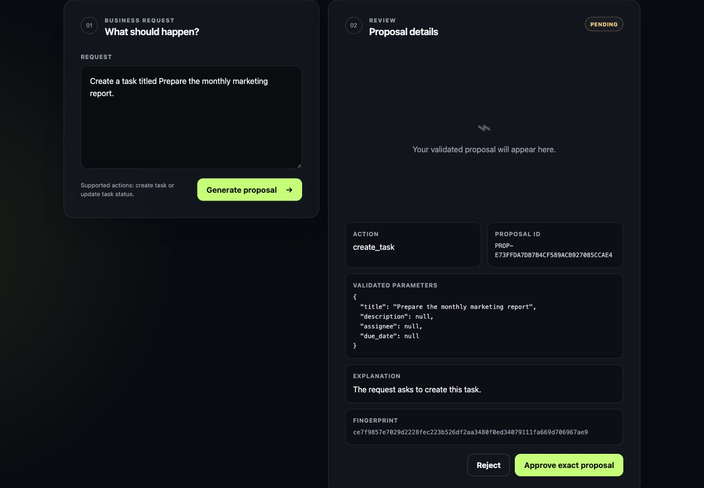
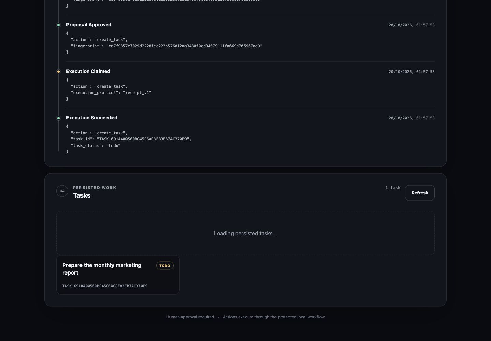
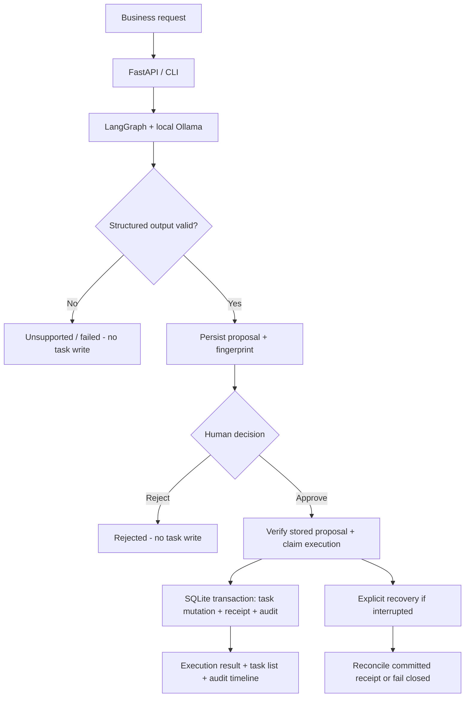

<div align="center">

# RELAINE

### Agentic workflows. Human decisions. Verifiable execution.

**A local-first business workflow agent built with LangGraph, Ollama, FastAPI, and SQLite.**

[](https://www.python.org/)
[](https://github.com/langchain-ai/langgraph)
[](https://fastapi.tiangolo.com/)
[](https://www.sqlite.org/)
[](#verification)

**[Quick start](#quick-start) · [How it works](#how-it-works) · [Architecture](#architecture) · [Verification](#verification) · [Limitations](#security-and-limitations)**

</div>

---

## See RELAINE in action

These are genuine captures of the running local application, using the installed `gpt-oss:20b` model and a separate synthetic SQLite demonstration database—not UI mockups.

**1. AI proposal, awaiting human approval**



**2. Approved execution, persistent task and audit history**



---

## The problem

Businesses want AI to help process operational requests, but an AI-generated instruction is **not** permission to change business data. A useful workflow agent needs to explain its proposed action, wait for human review, execute only what was authorized, and retain a reliable record of what happened—even after interruptions.

**RELAINE separates AI decision-making from business execution.** An installed local Ollama model proposes a structured task operation. Pydantic validates it; a human approves or rejects the *stored, fingerprinted proposal*; and only the authorized operation can change the persistent SQLite task database.

> **Scope:** This is a verified portfolio MVP for local demonstrations, **not** a multi-user, internet-facing production service.

## What you can do

| Capability | Implementation |
| --- | --- |
| Generate proposals | Real Ollama model inference through LangGraph, with structured Pydantic validation |
| Create business tasks | Persistent SQLite `create_task` operation |
| Update task progress | `update_task` changes an existing task's status: `todo`, `in_progress`, or `done` |
| Review before execution | Human approval/rejection of an immutable proposal snapshot and fingerprint |
| Avoid duplicate database effects | Atomic SQLite task mutation, execution receipt, and audit recording |
| Recover interrupted executions | Explicit, fingerprint-checked recovery and read-only stalled-execution discovery |
| Understand what happened | Append-only-under-schema audit events and per-proposal timeline |
| Use it in a browser | Same-origin FastAPI-served responsive HTML/CSS/JavaScript interface |
| Continue after refreshing | Restore the last referenced proposal from authoritative server state |
| Inspect tasks | Read-only, bounded task list from persistent SQLite records |

### Supported operations

- **Create a task**, for example: `Create a task titled Prepare the monthly report.`
- **Update a task's status**, for example: `Mark task TASK-... as done.` Use a real task ID returned by RELAINE.

Unsupported requests, missing parameters, invalid model output, and unavailable inference are represented as failures or unsupported states; RELAINE does not pretend they were executed.

## How it works



**Important distinction:** An LLM produces a *proposal*, not an executable instruction with unrestricted permissions. RELAINE executes only a supported operation whose reviewed identity still matches the persisted proposal.

## Architecture

| Layer | Technology | Responsibility |
| --- | --- | --- |
| Inference | Ollama + `langchain-ollama` | Generate structured action proposals locally |
| Orchestration | LangGraph | Workflow states and human-in-the-loop interruption/resumption |
| Contracts | Pydantic | Validate requests, proposals, tool parameters and responses |
| Application/API | FastAPI + Uvicorn | Same-origin HTTP endpoints and bundled local UI |
| Business storage | SQLite | Persist tasks and operation results |
| Reliability | SQLite transactions + execution receipts | Prevent repeat SQLite side effects across tested recovery scenarios |
| Workflow persistence | LangGraph SQLite checkpointer | Persist workflow progress and resume state |
| Evidence | SQLite audit events | Trace proposal, decision, execution and recovery lifecycle |
| Testing | pytest + HTTPX | Mock-model tests and optional real-model HTTP integration |

The interface is intentionally buildless: plain HTML, CSS and JavaScript packaged inside the Python wheel. No Node or frontend build pipeline is required.

## Quick start

### Prerequisites

- **Python 3.12** and [uv](https://docs.astral.sh/uv/)
- [Ollama](https://ollama.com/) running locally, with a compatible model **already installed**
- Default model: `gpt-oss:20b`. RELAINE does **not** download models automatically.

```bash
# Clone and install the locked project environment
git clone https://github.com/fadel-santiago/relaine.git
cd relaine
uv sync --frozen --python 3.12

# Check the models already on your machine
ollama list

# Optional: select a compatible model you already have
export RELAINE_OLLAMA_MODEL="gpt-oss:20b"

# Start the local application
uv run relaine-api --db-path relaine_tasks.sqlite3
```

Open **http://127.0.0.1:8000/** in your browser. Ollama must be running separately on its default local endpoint (`http://127.0.0.1:11434`) or the configured `RELAINE_OLLAMA_BASE_URL`.

From the web interface: submit a supported task request → inspect the generated proposal → approve or reject → inspect the actual task result and execution history.

### Command-line options

```bash
# Proposal-only command: does NOT write tasks
uv run relaine "Create a task titled Prepare the quarterly report"

# Controlled workflow: persist a proposed action
uv run relaine-control --db-path relaine_tasks.sqlite3 submit \
  "Create a task titled Prepare the quarterly report"

# Inspect before authorizing any action
uv run relaine-control --db-path relaine_tasks.sqlite3 inspect PROPOSAL_ID

# Review its history
uv run relaine-control --db-path relaine_tasks.sqlite3 history PROPOSAL_ID

# Explicitly approve or reject the stored proposal (requires actual fingerprint)
uv run relaine-control --db-path relaine_tasks.sqlite3 approve PROPOSAL_ID FINGERPRINT
uv run relaine-control --db-path relaine_tasks.sqlite3 reject PROPOSAL_ID FINGERPRINT

# Operator recovery tools
uv run relaine-control --db-path relaine_tasks.sqlite3 recover-list
uv run relaine-control --db-path relaine_tasks.sqlite3 recover PROPOSAL_ID FINGERPRINT
```

Replace `PROPOSAL_ID` and `FINGERPRINT` with values returned by RELAINE; do not run both approval and rejection for one proposal. The web UI provides the normal interactive path.

### HTTP API (local only)

| Method | Endpoint | Purpose |
| --- | --- | --- |
| `POST` | `/proposals` | Generate and persist a proposal |
| `GET` | `/proposals/{proposal_id}` | Inspect stored proposal and current status |
| `POST` | `/proposals/{proposal_id}/approve` | Approve the matching fingerprint and execute authorized tool |
| `POST` | `/proposals/{proposal_id}/reject` | Reject without business mutation |
| `GET` | `/tasks` | Read persisted tasks (bounded list) |
| `GET` | `/proposals/{proposal_id}/history` | Read proposal audit timeline |

The browser uses these same-origin endpoints; write operations are **not authenticated** and must **not** be exposed to the public internet.

## Verification

These are recorded outcomes from the October 2026 engineering and release runs, not guarantees for future environments.

| Verification | Reported result |
| --- | --- |
| Full non-Ollama regression suite | **103 passed**; 2 Ollama-marked tests excluded |
| Real Ollama smoke test | **1 passed** using installed `gpt-oss:20b` |
| Live HTTP end-to-end test | **1 passed** using Uvicorn + HTTPX + real Ollama + temporary SQLite |
| Approval/rejection | Approved creation persisted; rejected update caused no task change |
| Duplicate prevention | Repeated approval returned HTTP 409; one task and receipt remained |
| Restart persistence | Proposals, task and audit history survived process restart |
| Packaging | Python 3.12.15; fresh hash-verified runtime installation; wheel with all frontend assets |
| Reproducibility | Two independent wheel builds produced matching SHA-256 hashes |

The real-model run also exposed imperfect structured responses before a prompt correction. Invalid results failed closed rather than becoming business mutations. This is a useful reliability test, **not** evidence that LLM output is always accurate.

Run the non-Ollama tests:

```bash
uv run pytest -q
```

Run the two tests that require a locally available Ollama service/model:

```bash
uv run pytest -q -m ollama
```

The real-model integration test uses loopback HTTP and an isolated temporary database. It is not part of the default test run.

## Security and limitations

- **Local-only server:** Uvicorn binds to `127.0.0.1`; there is no login or authorization layer for internet-facing use.
- **Narrow tool scope:** only task creation and task-status updates are supported; arbitrary tool execution is intentionally unavailable.
- **Human-in-the-loop:** write operations require approval of the persisted, fingerprint-checked proposal.
- **SQLite-specific idempotency:** atomic task mutation/receipt/audit protects supported SQLite operations in tested scenarios; it does **not** imply exactly-once guarantees for arbitrary external APIs.
- **Manual recovery:** interrupted executions can be discovered and reconciled by an operator; no background recovery worker is provided. Ambiguous legacy records fail closed.
- **Audit integrity:** the audit is append-only under its installed SQLite schema, **not** cryptographically tamper-evident or protected against a database owner rewriting data.
- **Bounded history:** the HTTP audit timeline exposes up to 200 events and reports whether the result is complete. The task list is similarly bounded.
- **Model reliability:** structured generation is probabilistic. Invalid or unavailable model results are surfaced as errors, not assumed successful.
- **Integration scope:** RELAINE works independently; ATLAST retrieval is a potential future integration, **not** part of v0.1.0.
- **No public hosted demo yet:** reproduce it locally or use a genuine recorded walkthrough when one is available.

## Why this project matters

RELAINE demonstrates more than calling an LLM. It combines **agent orchestration, typed contracts, human authorization, persistent business tools, transactional idempotency, recovery, HTTP interfaces, and operational observability** in one testable local application.

**Status:** `v0.1.0` — verified local portfolio MVP. Engineering evidence is documented above; production readiness is not claimed.

---

<div align="center">

Built as an AI engineering portfolio project by **[Fadel Santiago](https://github.com/fadel-santiago)**.

[Back to top](#relaine)

</div>
